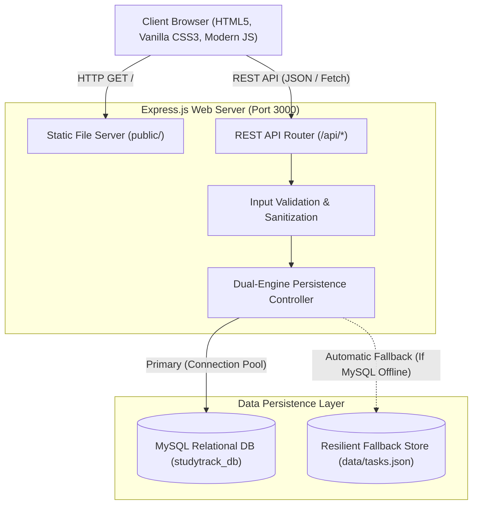

# 🎓 StudyTrack Pro — Student Task & Assignment Manager

> A modern, full-stack student task and assignment management web application built with **Node.js**, **Express.js**, **MySQL**, **HTML5**, and **Vanilla CSS3**.


---

## 📖 Table of Contents
- [✨ Key Features](#-key-features)
- [🏗️ System Architecture](#️-system-architecture)
- [💻 Tech Stack](#-tech-stack)
- [📁 Project Folder Structure](#-project-folder-structure)
- [🗄️ MySQL Database Schema](#️-mysql-database-schema)
- [📡 REST API Documentation](#-rest-api-documentation)
- [🚀 Quick Start & Local Setup](#-quick-start--local-setup)
- [🌐 Vercel Deployment Guide](#-vercel-deployment-guide)
- [🐙 GitHub Setup & Push Guide](#-github-setup--push-guide)

---

## ✨ Key Features

1. **➕ Add New Tasks & Assignments**:
   - Quick entry form matching academic coursework requirements.
   - Fields: Assignment Title, Course/Subject, Due Date, Category (*Assignment, Book Reading, Project, Exam Prep, Daily Study Task*), Priority level (*Low, Medium, High*), and optional notes/description.

2. **📋 Interactive Task List & Display**:
   - Displays all tasks organized by deadlines and priority.
   - Status indicators: Relative deadline badges (*Overdue*, *Due Today*, *Due Tomorrow*, *Due in X days*).
   - Course subject tags and color-coded priority pills.

3. **✅ One-Click Completion Toggle**:
   - Instant checkbox toggle to mark tasks as completed or pending.
   - Smooth animated strikethrough transition and instant UI feedback.

4. **🗑️ Delete Task**:
   - Secure deletion with confirmation to avoid accidental data loss.

5. **📊 Pending & Completed Task Views**:
   - Segmented status tabs: **All Tasks**, **Pending (In Progress)**, and **Completed**.
   - Sidebar presets: High Priority, Due Today, and Course Filter dropdown.

6. **📈 Live Student Productivity Metrics (KPIs)**:
   - **Total Tasks**: Total count of active coursework.
   - **Pending Tasks**: Highlighting urgent items requiring attention.
   - **Completed Tasks**: Track completed milestones.
   - **Completion Rate**: Animated percentage bar showing overall academic progress.

7. **🛡️ Dual-Engine Persistence (MySQL + Resilient Fallback)**:
   - Primary: High-performance MySQL relational database with connection pooling.
   - Fallback: Auto-switching local file store ensuring 100% uptime even if a local MySQL instance is not running or on serverless hosting platforms.

---

## 🏗️ System Architecture



---

## 💻 Tech Stack

| Layer | Technology | Description |
| :--- | :--- | :--- |
| **Frontend** | HTML5 Semantic Markup | Clean, accessible DOM structure |
| **Styling** | Vanilla CSS3 (Custom Design System) | Plus Jakarta Sans font, CSS variables, glassmorphic cards, responsive grid |
| **Client Logic** | Vanilla JavaScript (ES6+) | Asynchronous `fetch()`, DOM manipulation, debounced search, modal controls |
| **Backend** | Node.js & Express.js | Robust RESTful API architecture, CORS, middleware, static routing |
| **Database** | MySQL 8.0+ / MariaDB | Relational table structure with indexing, foreign keys, timestamps |
| **DB Client** | `mysql2/promise` | Async connection pool with prepared statements preventing SQL injection |
| **Deployment** | Vercel Serverless | `@vercel/node` serverless function adapter (`api/index.js`) |

---

## 📁 Project Folder Structure

```text
studytrack-pro/
├── api/
│   └── index.js              # Serverless entry point for Vercel
├── data/
│   └── tasks.json            # Seed data & resilient storage fallback
├── public/
│   ├── css/
│   │   └── style.css         # Complete responsive stylesheet & design system
│   ├── js/
│   │   └── app.js            # Client-side CRUD controller & interactions
│   └── index.html            # StudyTrack Pro single-page dashboard
├── .env.example              # Environment variables template
├── .gitignore                # Git ignore rules for node_modules, .env, .vercel
├── database.sql              # Complete MySQL DDL schema and seed queries
├── package.json              # Project metadata & dependencies
├── server.js                 # Express server & dual-engine database controller
├── vercel.json               # Vercel deployment routing configuration
└── README.md                 # Complete project documentation
```

---

## 🗄️ MySQL Database Schema

The database schema is defined in [`database.sql`](file:///home/sabari/resol/conta/database.sql):

```sql
CREATE DATABASE IF NOT EXISTS studytrack_db CHARACTER SET utf8mb4 COLLATE utf8mb4_unicode_ci;
USE studytrack_db;

CREATE TABLE IF NOT EXISTS tasks (
    id INT AUTO_INCREMENT PRIMARY KEY,
    title VARCHAR(255) NOT NULL,
    subject VARCHAR(100) NOT NULL,
    category VARCHAR(50) NOT NULL DEFAULT 'Assignment',
    due_date DATE NOT NULL,
    priority ENUM('low', 'medium', 'high') NOT NULL DEFAULT 'medium',
    status ENUM('pending', 'completed') NOT NULL DEFAULT 'pending',
    description TEXT NULL,
    created_at TIMESTAMP DEFAULT CURRENT_TIMESTAMP,
    updated_at TIMESTAMP DEFAULT CURRENT_TIMESTAMP ON UPDATE CURRENT_TIMESTAMP
) ENGINE=InnoDB DEFAULT CHARSET=utf8mb4 COLLATE=utf8mb4_unicode_ci;
```

---

## 📡 REST API Documentation

| Method | Endpoint | Description | Sample Payload / Params |
| :--- | :--- | :--- | :--- |
| `GET` | `/api/health` | Check server and active DB engine | None |
| `GET` | `/api/stats` | Retrieve total, pending, completed, rate | None |
| `GET` | `/api/tasks` | List tasks (supports query filters) | `?status=pending&priority=high` |
| `GET` | `/api/tasks/:id` | Get details of a single task | `id` parameter |
| `POST` | `/api/tasks` | Create a new student task | `{"title":"...","subject":"...","due_date":"YYYY-MM-DD"}` |
| `PATCH` | `/api/tasks/:id/toggle` | Toggle pending ⟷ completed | `id` parameter |
| `PUT` | `/api/tasks/:id` | Update full task details | Complete task object |
| `DELETE` | `/api/tasks/:id` | Delete a task | `id` parameter |
| `POST` | `/api/tasks/seed` | Reset demo academic tasks | None |

---

## 🚀 Quick Start & Local Setup

### 1. Prerequisites
- **Node.js** (v18.0.0 or higher)
- **npm** (v9.0.0 or higher)
- **MySQL Server** (Optional: the app runs with automatic resilient storage if MySQL is not running)

### 2. Clone and Install
```bash
git clone https://github.com/tamilsabari397-dev/task.git
cd task
npm install
```

### 3. Configure Database (Optional for MySQL)
Create a `.env` file from `.env.example`:
```bash
cp .env.example .env
```
Edit `.env` with your MySQL credentials:
```env
PORT=3000
DB_HOST=localhost
DB_USER=root
DB_PASSWORD=your_password
DB_NAME=studytrack_db
DB_PORT=3306
```

Run the database setup script in MySQL:
```bash
mysql -u root -p < database.sql
```

### 4. Start the Application
```bash
# Start standard server
npm start

# Or start in watch mode for development
npm run dev
```

Visit **`http://localhost:3000`** in your browser.

---

## 🌐 Vercel Deployment Guide

StudyTrack Pro is pre-configured for **Vercel Serverless Functions** with [`vercel.json`](file:///home/sabari/resol/conta/vercel.json) and [`api/index.js`](file:///home/sabari/resol/conta/api/index.js).

### Method 1: Deploy with Vercel CLI
```bash
npx vercel deploy --prod
```

### Method 2: Deploy from GitHub (Automatic CI/CD)
1. Push your code to GitHub.
2. Go to [vercel.com/new](https://vercel.com/new).
3. Select your repository and click **Import**.
4. (Optional) In **Environment Variables**, add your cloud MySQL credentials (`DB_HOST`, `DB_USER`, `DB_PASSWORD`, `DB_NAME`, `DB_PORT`) from providers like Aiven, TiDB, PlanetScale, or Supabase. If omitted, the app automatically runs in resilient serverless mode!
5. Click **Deploy**.

---

## 🐙 GitHub Setup & Push Guide

To push your repository to your GitHub account:

```bash
# 1. Initialize git
git init
git branch -M main

# 2. Stage and commit files
git add .
git commit -m "feat: initial release of StudyTrack Pro student task manager"

# 3. Add remote (replace with your repo URL)
git remote add origin git@github.com:tamilsabari397-dev/task.git

# 4. Push to GitHub
git push -u origin main
```

---

## 📄 License
This project is open source and available under the [MIT License](LICENSE).
